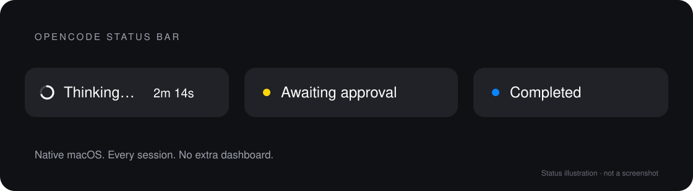

<div align="center">

# OpenCode Status Bar

### Your agents are working. You shouldn't have to watch them.

A tiny, native macOS menu-bar companion for **OpenCode**. Know when it's thinking, when it needs you, and when it's done—without switching windows.

[](https://github.com/yiaany/opencode-status-bar/releases)
[](https://github.com/yiaany/opencode-status-bar/releases)
[](LICENSE)

[Download for macOS](https://github.com/yiaany/opencode-status-bar/releases/latest) · [Install with Homebrew](#install) · [Report a bug](https://github.com/yiaany/opencode-status-bar/issues)



</div>

## Less checking. More flow.

Start a task in OpenCode and get back to your work. A glance at your menu bar tells you everything:

| Status | What you see |
| --- | --- |
| **Working** | Smooth, slow spinner, a soft `Thinking…` brightness wave, and a readable elapsed timer |
| **Needs you** | Yellow dot + `Awaiting approval`, prioritised over working sessions |
| **Done, unread** | Blue dot + `Completed` until you view the session |

- **All your sessions, one menu.** Sessions appear directly in the dropdown, with titles and tool activity.
- **One click back to the conversation.** Jump to the exact session in OpenCode Desktop—not just the app.
- **Native, not another dashboard.** Swift + AppKit. No Electron wrapper, Dock icon, or account.
- **Quiet by design.** White/adaptive text, colour only where it matters, and no cycling status words.
- **Local by design.** No analytics or cloud service. No prompts, transcripts, source code, or credentials saved.
- **Universal binary.** One download for Apple Silicon and Intel Macs.

## Install

Requires **macOS 12+** and **OpenCode V2**. Desktop integration was tested with OpenCode 2.2.0; the GUI API is experimental. V1 is not supported.

### 1. Install the app

```sh
brew install --cask yiaany/tap/opencode-status-bar
open -a "OpenCode Status Bar"
```

Or download **[OpenCodeStatusBar.dmg](https://github.com/yiaany/opencode-status-bar/releases/latest)** and drag the app into Applications.

> [!IMPORTANT]
> The initial release is ad-hoc signed, **not Apple-notarized**. macOS may block the first launch. After verifying the download source, use **System Settings → Privacy & Security → Open Anyway**. Homebrew distribution uses the maintainer's tap, not the official Homebrew cask repository.

### 2. Connect OpenCode

The app includes the plugin. Add its absolute path to your **global** `~/.config/opencode/opencode.json` (or `.jsonc`), preserving your existing settings and plugin entries:

```jsonc
{
  "$schema": "https://opencode.ai/config.json",
  "plugins": [
    "/Applications/OpenCode Status Bar.app/Contents/Resources/plugin"
  ]
}
```

OpenCode reloads configuration automatically; `/reload` forces a refresh. Start a task to see its status. Global installation is required for the Desktop navigation plugin. No npm package installation is needed.

For a source checkout, use `/absolute/path/to/opencode-status-bar/plugin` instead. If you install the app somewhere else, adjust the path above.

### 3. Work somewhere else

Leave OpenCode running. The menu bar follows its session events; click a session to return to it in Desktop. CLI/TUI sessions are tracked too, but clicking them opens Desktop, not the originating terminal window. Exact navigation currently targets Desktop's local server; remote/custom servers are not supported.

## How it works

```text
OpenCode V2 events → local plugin → small JSON status files → native menu bar
```

The plugin writes session IDs, titles, project paths, status labels, and timestamps under `~/.opencode/status-bar/sessions/`. The app reads these files locally. A GUI plugin handles exact-session navigation in Desktop. No polling of conversations, no accessibility scraping, no model calls.

Animation targets 60 Hz with a time-based angle: smoother frames do not mean faster rotation. Reduced Motion disables the text wave. Status files expire after 24 hours; an unexpectedly terminated OpenCode run can leave a stale indicator until then.

## Build from source

Requires Xcode Command Line Tools and Node.js 22+ for plugin checks.

```sh
git clone https://github.com/yiaany/opencode-status-bar.git
cd opencode-status-bar
npm ci --prefix plugin
npm run check --prefix plugin
npm test --prefix plugin
./build.sh --dmg
open "build/OpenCode Status Bar.app"
```

The build produces an ad-hoc-signed universal app and `build/OpenCodeStatusBar.dmg`. It does not require Swift package dependencies.

## Update or uninstall

```sh
brew upgrade --cask yiaany/tap/opencode-status-bar
```

To uninstall, remove this plugin's entry from your OpenCode configuration, quit the app, then run `brew uninstall --cask opencode-status-bar` (or move the manually installed app to Trash). Local status files can be removed separately. Your OpenCode sessions and configuration are never deleted by the app.

## Made by Ilya

Built and maintained by **[Ilya · @yiaany](https://github.com/yiaany)**. Independent, open-source, and not affiliated with or endorsed by the OpenCode team.

[Contribute](CONTRIBUTE.md) · [Troubleshooting](TROUBLESHOOTING.md) · [Privacy](PRIVACY.md) · [Homebrew](HOMEBREW.md)

MIT licensed. This project began from an MIT-licensed menu-bar app; required attribution is preserved in [third-party notices](THIRD-PARTY-LICENSES.md).
